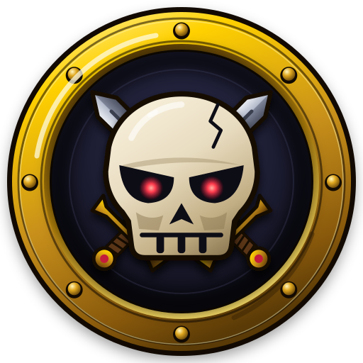

<p align="center"></p>

# BetterRareSpawns

A rare spawn tracker for World of Warcraft (built and tested against the `wowf` client, Interface 16001).
No libraries, no bundled art, about 200 KB.

## What it does

- **Finds rares** from nameplates, mouseover, target, minimap vignettes and monster yells. Anything the
  client classifies as rare or rare elite is learned on sight, so it works with no database at all.
- **Scan key** (Key Bindings > AddOns): one key that tries to target every rare near you. Uses no macro
  slot. The list follows you as you move and puts the most likely rares first.
- **Respawn timers** learned from what you witness (death, then the next spawn), kept per layer.
- **World map pins** coloured by state: up, window open, overdue, dead, unknown. Pins that would overlap
  merge into one counted pin and split when you zoom in. Continent maps show only rares worth the trip.
- **Hover card** next to the pin: instant, never under the cursor, timers count live, and stacked pins
  list every rare in one card.
- **Minimap dots**, with the tracked rare pinned to the rim when it is out of range.
- **Rare journal** (`/brs`): a book of every known rare in the game's spellbook frame. Twelve to a page,
  with tabs (all, this zone, active, wanted, not killed yet, dungeon rares, beast families, seen by you,
  hidden), search by name, zone, level, pet family or drop, and zone /
  level / sort filters. Each rare has its own page: 3D model, level, health, where it spawns, its timer,
  and its drops as item buttons with the normal item tooltips.
- **Zone list** (`/brs list`) for the current zone, most promising first.
- **Kill log**: kills you got credit for (group kill or loot), with first-kill date, a tick on the map pin and
  journal row, and "killed 42 / 438" progress.
- **Wanted list**: star a rare, or right-click one of its drops to want that item (every rare dropping it
  becomes wanted). Wanted rares alert louder, stay on the continent map, and raise a notice when their spawn
  window opens, wherever you are.
- **Camp bar**: stand at a spawn point for a few seconds (or `/brs camp`) and a bar counts down to the spawn
  window, with a sound when it opens.
- **Announce**: one click on the alert or the journal page tells your group or guild; shift-click says it in
  General. Only ever on your click.
- **Guild sync**: at login the addon asks the guild for its recent deaths and learned respawn times; one
  member answers.
- **Minimap button** with a count of rares that are up, and a data broker feed for bar addons.
- **Uncluttered map**: one pin per rare by default; hover it (or track it) and its other spawn points appear.
  A rare is a plain disc in its timer colour with a silver ring, a rare elite adds a skull and a gold ring.
- **Minimap pins across zone borders**: a spawn point just over the border still shows on the minimap.
- **Scan key binder** in the options window: click, press a key, done.
- **Setup check** at first login (and `/brs setup`): says when the rare database is missing, the scan key is
  unbound, enemy nameplates are off, or another rare addon is running alongside.
- **Sharing** of sightings, deaths and respawn times with guild and group over hidden addon messages.

## Controls

| Where | Action | Result |
| --- | --- | --- |
| Map pin, list row | Click | Waypoint and track |
| | Shift-click | Put name, coordinates and status in the chat box |
| | Ctrl-click | Open that rare's journal page |
| | Alt-click | Hide that rare (`/brs unhide` to undo) |
| Journal | Mouse wheel / arrows | Turn the page, or step to the next rare |
| | Show on Map | Opens the map on its zone and lights up its pins |
| Map button | Click / shift-click / right-click | Pins on or off / journal / options |
| Map pin | Right-click | Zooms the map out, as usual |
| Alert card | Click / right-click | Target the rare / dismiss |

`/brs help` lists the commands.

## Data

The addon ships no rare database. Rares come from:

1. what you see in the world (always), and
2. the [QuestieDB](https://github.com/Questie/QuestieDB) addon, if you have it installed. Its rare and
   rare elite NPCs, and the items they drop, are read at runtime and cached in your own saved variables.
   Nothing from it is redistributed here.

Drops you loot yourself are recorded too, with a count, and are listed first.

Also read from QuestieDB: quests a rare starts, drops that start a quest, and which rares live in dungeons.
Two things no database here knows are learned from the game itself: the pet family (from the living
creature) and whether the corpse can be skinned, mined or picked (from its tooltip). Those appear once you
have met the rare.

## Look

Every window is drawn with the game's own art and frame templates, referenced by path: the spellbook frame
for the journal, tooltip borders for the hover card, alert and zone list, the dialog box for options, panel
buttons, check boxes, the minimap button ring for map pins. The addon ships no textures.

## Install

From CurseForge, or copy this folder into `Interface/AddOns` as `BetterRareSpawns`.

## Releasing

Tag a commit `vX.Y.Z` and push the tag. The release workflow runs the tests, builds the zip with the BigWigs
packager, attaches it to a GitHub release and uploads it to CurseForge.

## License

MIT, see [LICENSE](LICENSE). Author: Heavy C.

## Development

```
pip install lupa
python tests/run.py
```

The tests load the addon in Lua 5.1 against a stubbed game API (`tests/wowstub.lua`) and drive it through
events. They check logic, not rendering: anything visual still needs a look in the game.
